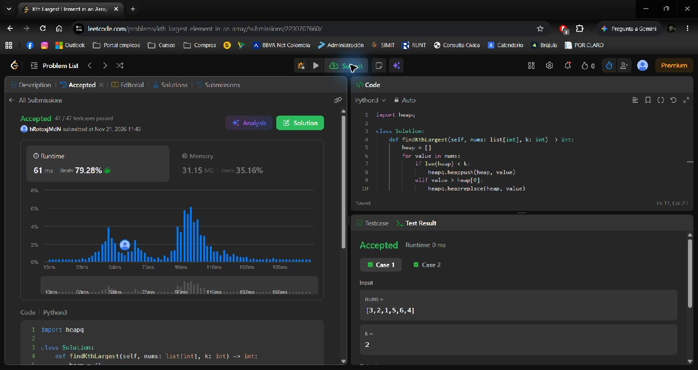
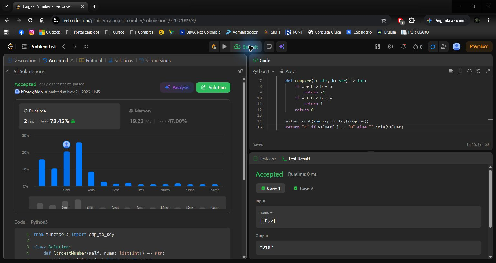
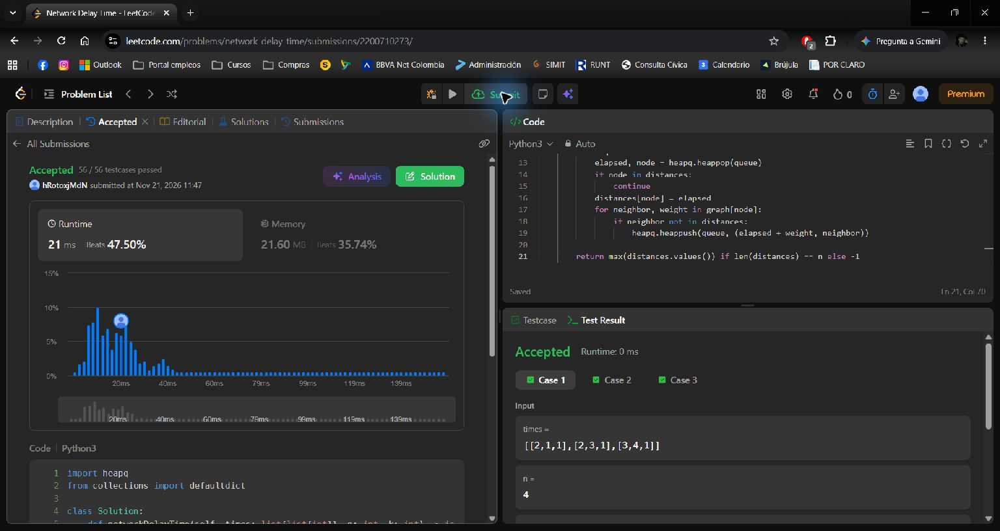
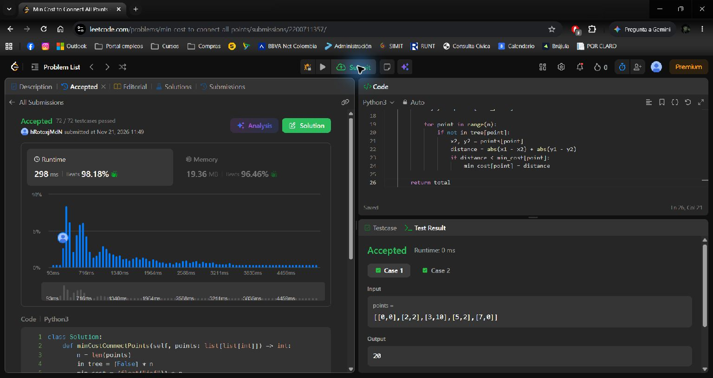
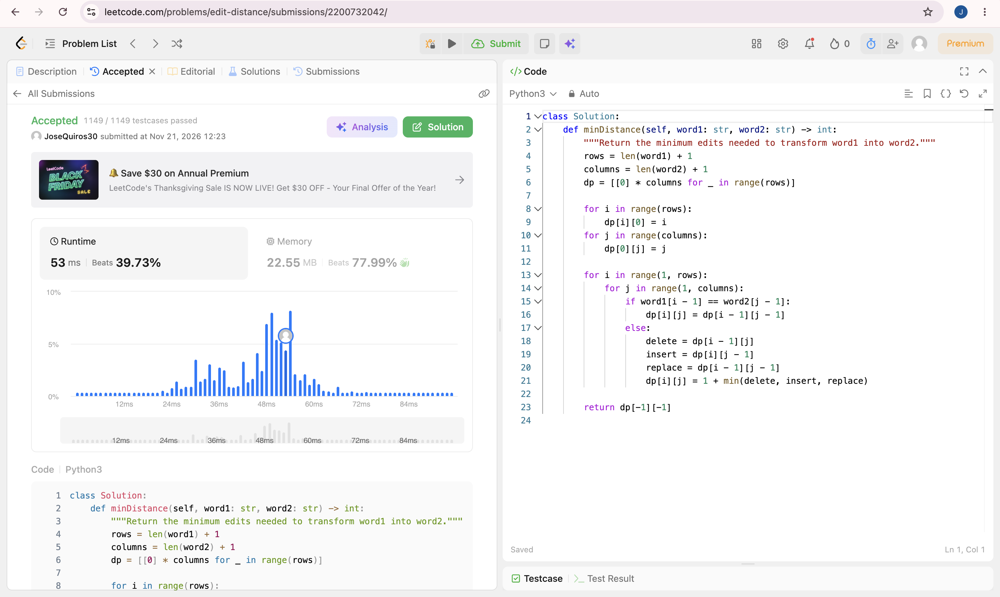
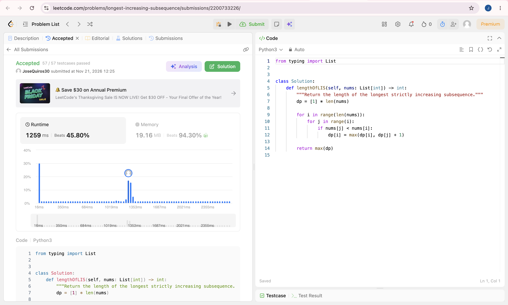
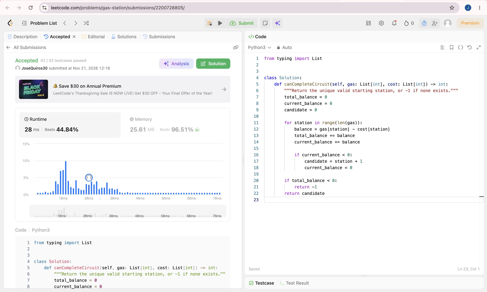
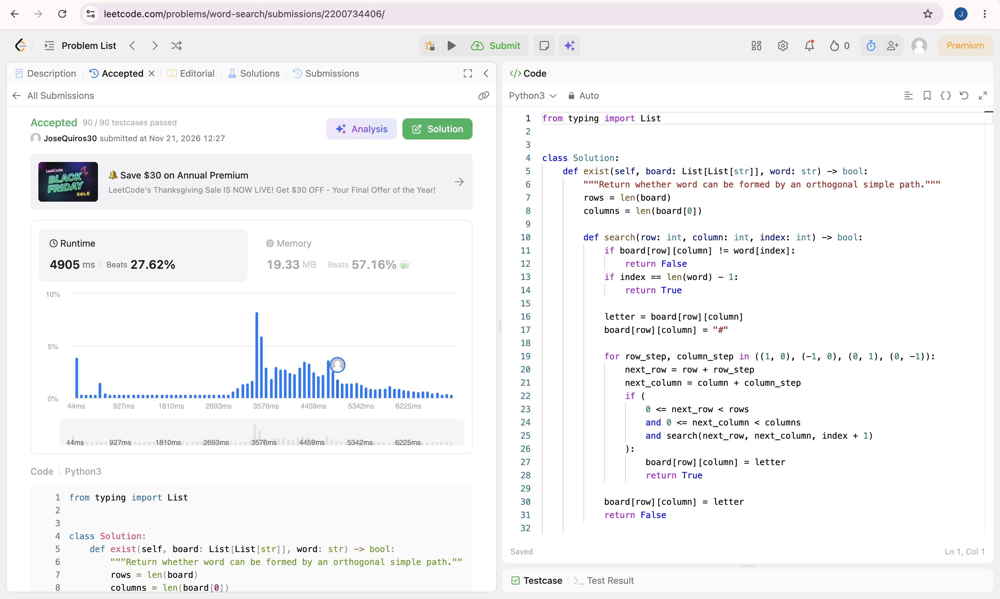

# Taller final

Curso: Análisis de algoritmos · ITM · 2026-2

## Autoría

| Integrante | Usuario de Git | Ejercicios |
| --- | --- | --- |
| Anderson | `AndersonArleyC` | 215, 179, 743, 1584 |
| José Quirós | `JoseQuiros30` | 72, 300, 134, 79 |

> Antes de entregar, combine este contenido con el `README.md` general del grupo y agregue los demás integrantes.

## 1. [215. Kth Largest Element in an Array](https://leetcode.com/problems/kth-largest-element-in-an-array/)

Autor: Anderson (`AndersonArleyC`)  
Familia: heap  

**Idea.** Se mantiene un min-heap con los `k` valores más grandes encontrados. Cuando el heap supera el tamaño `k`, se elimina su mínimo. Al finalizar, la raíz es el k-ésimo mayor, pues es el menor elemento entre los `k` mayores.

**Complejidad.** Para `n = len(nums)`, tiempo `O(n log k)` y espacio extra `O(k)`.

Código: [`kth-largest/solution.py`](kth-largest/solution.py)  

## 2. [179. Largest Number](https://leetcode.com/problems/largest-number/)

Autor: Anderson (`AndersonArleyC`)  
Familia: ordenamiento con comparador personalizado  

**Idea.** Los números se convierten a cadenas. Para dos cadenas `a` y `b`, `a` debe aparecer primero cuando `a + b > b + a`. Después de ordenar con esa regla, se concatenan las cadenas. Si el primer elemento es `"0"`, todos los números son cero y se devuelve `"0"`.

**Complejidad.** Para `n` números y longitud máxima `d`, el ordenamiento realiza `O(n log n)` comparaciones de costo `O(d)`: tiempo `O(d n log n)`. El espacio para las cadenas y el resultado es `O(nd)`; el sort de Python puede requerir además `O(n)` referencias auxiliares.

Código: [`largest-number/solution.py`](largest-number/solution.py)  

## 3. [743. Network Delay Time](https://leetcode.com/problems/network-delay-time/)

Autor: Anderson (`AndersonArleyC`)  
Familia: grafos — Dijkstra  

**Modelo.** Cada dispositivo es un vértice y cada registro `[u, v, w]` es un arco dirigido de `u` a `v` con peso no negativo `w`.

**Idea.** Se ejecuta Dijkstra desde `k` usando un min-heap de pares `(distancia, nodo)`. Cuando se extrae por primera vez un nodo no procesado, su distancia es definitiva. Si se alcanzan todos los nodos, la mayor distancia definitiva es el tiempo en que todos recibieron la señal; si falta alguno, se devuelve `-1`.

**Complejidad.** Con `n` vértices y `m = len(times)` arcos, tiempo `O((n + m) log n)` y espacio `O(n + m)`.

Código: [`network-delay-time/solution.py`](network-delay-time/solution.py)  

## 4. [1584. Min Cost to Connect All Points](https://leetcode.com/problems/min-cost-to-connect-all-points/)

Autor: Anderson (`AndersonArleyC`)  
Familia: grafos — árbol de recubrimiento mínimo (Prim)

**Modelo.** Cada punto es un vértice de un grafo completo no dirigido. El peso entre dos puntos es su distancia de Manhattan.

**Idea.** Se usa Prim sin construir las `Theta(n^2)` aristas. En cada iteración se agrega al árbol el punto externo de menor costo conocido y se actualiza el costo de conectar los puntos restantes. La suma de las aristas elegidas es el costo del MST.

**Complejidad.** Para `n = len(points)`, tiempo `O(n^2)` y espacio extra `O(n)`.

Código: [`min-cost-to-connect-all-points/solution.py`](min-cost-to-connect-all-points/solution.py)  

## 5. [72. Edit Distance](https://leetcode.com/problems/edit-distance/)

Autor: José Quirós (`JoseQuiros30`)

Usuario de LeetCode: `JoseQuiros30`

Familia: programación dinámica

**Idea.** El estado `dp[i][j]` guarda el mínimo de ediciones para transformar los primeros `i` caracteres de `word1` en los primeros `j` de `word2`. Las bases son `dp[i][0] = i` y `dp[0][j] = j`. Si los caracteres finales coinciden se conserva `dp[i-1][j-1]`; de lo contrario, se suma uno al mínimo entre borrar, insertar y sustituir.

**Complejidad.** Con `n = len(word1)` y `m = len(word2)`, tiempo `Theta(nm)` y espacio `Theta(nm)`.

Código: [`edit-distance/solution.py`](edit-distance/solution.py)

## 6. [300. Longest Increasing Subsequence](https://leetcode.com/problems/longest-increasing-subsequence/)

Autor: José Quirós (`JoseQuiros30`)

Usuario de LeetCode: `JoseQuiros30`

Familia: programación dinámica

**Idea.** El estado `dp[i]` es la longitud de la subsecuencia estrictamente creciente más larga que termina en `i`, con base `dp[i] = 1`. Para cada `j < i` tal que `nums[j] < nums[i]`, se considera `dp[j] + 1`; la respuesta es el máximo de toda la tabla.

**Complejidad.** Para `n = len(nums)`, tiempo `Theta(n^2)` y espacio `Theta(n)`.

Código: [`longest-increasing-subsequence/solution.py`](longest-increasing-subsequence/solution.py)

## 7. [134. Gas Station](https://leetcode.com/problems/gas-station/)

Autor: José Quirós (`JoseQuiros30`)

Usuario de LeetCode: `JoseQuiros30`

Familia: greedy

**Idea.** Se recorre el circuito acumulando `gas[i] - cost[i]`. Si el tanque del candidato queda negativo en `i`, ninguna estación del tramo entre ese candidato e `i` puede servir, por lo que se descarta todo el tramo y el siguiente candidato es `i + 1`. Si el balance total es negativo, no existe solución.

**Complejidad.** Para `n = len(gas)`, tiempo `Theta(n)` y espacio extra `Theta(1)`.

Código: [`gas-station/solution.py`](gas-station/solution.py)

## 8. [79. Word Search](https://leetcode.com/problems/word-search/)

Autor: José Quirós (`JoseQuiros30`)

Usuario de LeetCode: `JoseQuiros30`

Familia: backtracking

**Idea.** Desde cada celda que pueda iniciar la palabra se elige un vecino ortogonal que coincida con la siguiente letra. La celda elegida se marca temporalmente para impedir reutilizarla y se restaura al regresar, permitiendo explorar las demás ramas.

**Complejidad.** En una grilla de `m x n` y para una palabra de longitud `L`, el peor caso es `O(mn * 4^L)` en tiempo y `O(L)` en espacio para la pila recursiva.

Código: [`word-search/solution.py`](word-search/solution.py)

## Evidencias

Las ocho capturas muestran el problema, el resultado `Accepted`, todos los casos aprobados, runtime, memoria y el usuario de LeetCode de la persona autora.

